# Task Notifier

[中文](./README.zh-CN.md) | **English**

[](https://www.npmjs.com/package/@polunzh/dsh-task-notifier)
[](https://dshopen.org/zh/plugins/@polunzh/dsh-task-notifier/)
[](https://dsh.127.dev/)
[](./LICENSE)
[](./package.json)

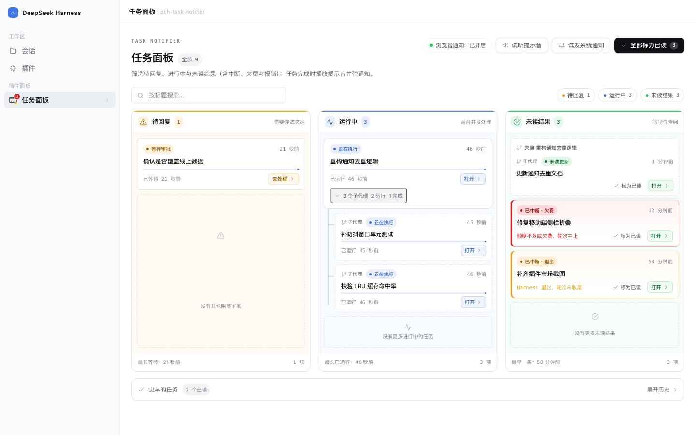

---

> A DeepSeek Harness (DSH) web plugin that **notifies you when a task finishes or is interrupted** and puts a **notification center** in the top-right corner of every screen — task results, account notices and notifications from other plugins all land there.

### What it solves

Long-running DSH sessions finish while you are looking somewhere else. This plugin pushes "done" to where you can see it:

- **Top-right notification center** — a bell visible on every screen (conversation, plugins page, settings) with an unread badge that aggregates all sources; clicking opens one inbox with `All / Unread / Action` and source filters, and **Open task panel** at the bottom reaches the original 3-lane board. Each row leads with a status rail (green done, amber/red interrupted, blue account, grey plugin) and names its sender at the head of the subtitle — `Task`, `Account notice` or `Plugin: dsh-todo`; hovering an unread row swaps its timestamp for a check that marks that one message read without opening it; repeated completions of one session collapse into a single row with "Completed N×", the unread badge no longer multiplies per turn, subagent runs stay silent until their parent session finishes, and background runs that reuse a title merge into one row within 24 hours.
- **Aggregates multiple sources** — this plugin's task events, built-in account notices, and notifications published by other plugins (`ctx.notifications.post()` or `window.dshNotifications`) all converge here; system notifications and the chime fire from one place, so sources never double-notify.
- **Chime** — when any session's turn ends, the browser synthesizes a short ascending chime (G5→C6); no audio assets needed.
- **Two notification channels**:
  - Page open and permission granted → browser `Notification`; clicking it jumps back to that session.
  - Page closed or permission not granted → the host raises a macOS system notification (`osascript`). A heartbeat keeps the two channels from double-firing.
- **Needs-input state** — when an agent asks you a question, waits for a plan review, or waits on an approval, the top-right bell badge counts it as **Action** and the panel pins a **Needs you** group, so you can jump straight to the session blocked on you.
- **Interruptions stay visible** — a turn cut short by quitting or crashing DSH, by an exhausted quota or balance, or by an execution error keeps an "Interrupted · Exited / Quota / Error" warning card in the inbox, and the system notification states the reason; sending a new message clears the mark.
- **Three-lane board** — reachable from **Expand** at the bottom of the notification panel: **needs input / running / unread** simultaneously, with top chip filters for a single lane, collapsible history, title search, mark-all-read, chime preview and test notification.
- **Session / subagent task tree** — sessions spawned by AgentTeams or subagents nest under their parent session with a connecting rail; the parent card shows "N subagents · running / done" and can fold them. When a child lands in a different lane, a "from <parent>" breadcrumb keeps the relationship visible across lanes.
- **Read state follows you** — opening a session from the sidebar marks its completed task read automatically.
- **Unread survives restarts** — task and notification snapshots live in `$DSH_HOME/storages/dsh-task-notifier/` (`state.json` + `notifications.json`).
- **Bilingual UI** — interface and system-notification text follow the host language (zh / en).

### Install

**Option 1 — via the Open Plugin Market (recommended; supports likes)**

Listed on the community market (category "workflow", source-verified ✅). In DSH: **Plugins → Experimental plugins** → enable **Custom plugin markets** → **Discover → Add index source**, then paste:

```
https://dshopen.org/index.json
```

Search for "任务通知台 / Task Notifier" and install. Market page: [dshopen plugin page](https://dshopen.org/zh/plugins/@polunzh/dsh-task-notifier/).

**Option 2 — via the self-hosted index (tracks updates)**

In DSH: **Plugins → Experimental plugins** → enable **Custom plugin markets** → **Discover → Add index source**, then paste:

```
https://dsh.127.dev/index.json
```

Search for "任务通知台 / Task Notifier" and install. New versions show as update-available; uninstall from **Installed**.
The index refreshes from npm every 6 hours — source at [dsh-plugins-index](https://github.com/polunzh/dsh-plugins-index).

**Option 3 — npm**

```bash
dsh plugin --profile desktop add @polunzh/dsh-task-notifier
```

**Option 4 — from a local checkout (development)**

Use `plugin_manager` with `install_bundle` and point `target` at this repository's absolute path.

### Configuration

Everything is optional. Put it in your profile's `cordis.patch.yml`:

```yaml
- insert:
    - id: polunzh-task-notifier
      name: '@polunzh/dsh-task-notifier'
      config:
        osNotify: auto            # auto | always | off
        sound: true               # browser chime on/off
        osSound: Glass            # macOS system sound name
        osTitle: DeepSeek Harness # system notification title
```

| Field | Default | Meaning |
|---|---|---|
| `osNotify` | `auto` | `auto` = browser notification while the page is live, system notification otherwise; `always` = always system notification; `off` = none |
| `sound` | `true` | Browser-synthesized chime |
| `osSound` | `Glass` | A built-in macOS sound name (Glass / Ping / Pop …) |
| `osTitle` | `DeepSeek Harness` | System notification title |

### Publishing notifications from other plugins

Other plugins can add entries to the same inbox:

- **Client** — when the service is available, `ctx.notifications.post({ id, source: 'plugin', sourceLabel, title, body, tone })`; a zero-dependency fallback is `window.dshNotifications.post(...)`.
- **Host** — inject `notifications` and call `ctx.notifications.post(entry)`.

`source` is `task | account | plugin`; `id` is the stable dedupe key. Account notices are read through the host account service and only appear in the inbox — they do not raise OS notifications.

### Privacy and security

- **No new outbound connections**: the plugin itself makes no network requests, telemetry or remote assets; the account-notice source reuses the host's existing account service.
- **Local only**: task and notification snapshots are written to `$DSH_HOME/storages/dsh-task-notifier/` (`state.json`, `notifications.json`; directory `0700`, files `0600`).
- **No credential reads**: never touches `~/.dsh/.credentials.yaml`, `.env`, keychain or SSH keys.
- **Fail-closed routing**: if the host connection guard is unavailable, requests are rejected instead of allowed.
- **No install-time scripts**: no `preinstall` / `postinstall` / `prepare` in `package.json`.

Threat model, limits and rate limits are documented in [SECURITY.md](./SECURITY.md).

### Upgrading from 1.1.0 / coexistence

Since 1.1.1 the browser module id is the package name (`@polunzh/dsh-task-notifier`) and the patch row id is
`polunzh-task-notifier`, so a different plugin that happens to share the old ids can no longer break DSH's boot.
If you previously installed a `link:` copy or an older version, **keep only one**: uninstall the old entry from
**Plugins → Installed** first, then install 1.1.1.

### Compatibility

| Item | Requirement |
|---|---|
| DSH | `>=0.2.0-rc.2` (declared in `engines.dsh`) |
| Node | `>=20` |
| Platform | Any platform for the web UI; **system notifications are macOS-only**, other platforms get browser notifications |
| Browser notifications | Require an explicit user gesture (the plugin never prompts in the background) |

### Screenshots

| Notification center (light) | Notification center (dark) |
|---|---|
| 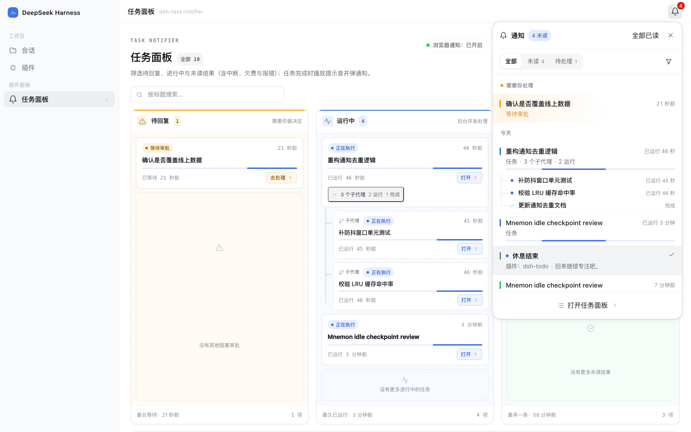 | 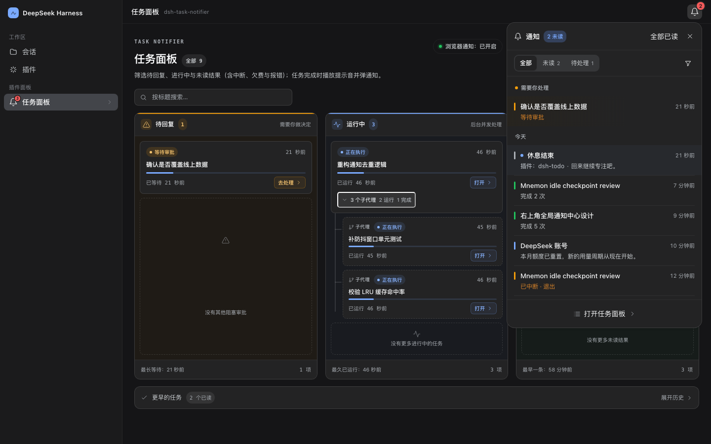 |

| Notification center (English) | Design sheet (row anatomy and colours) |
|---|---|
| 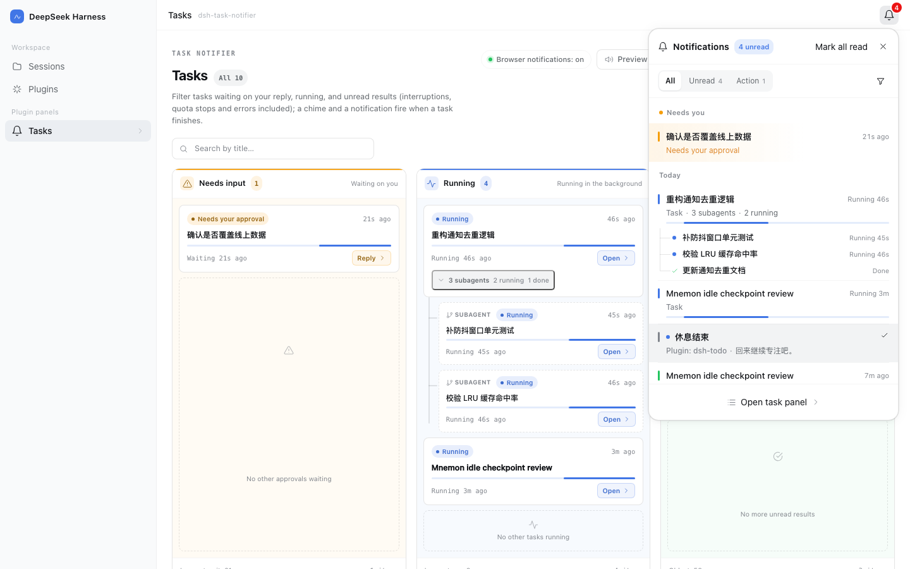 | 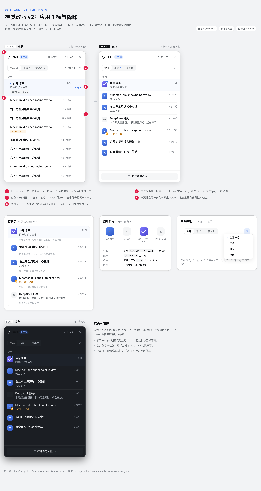 |

| Light board | Dark board |
|---|---|
|  | 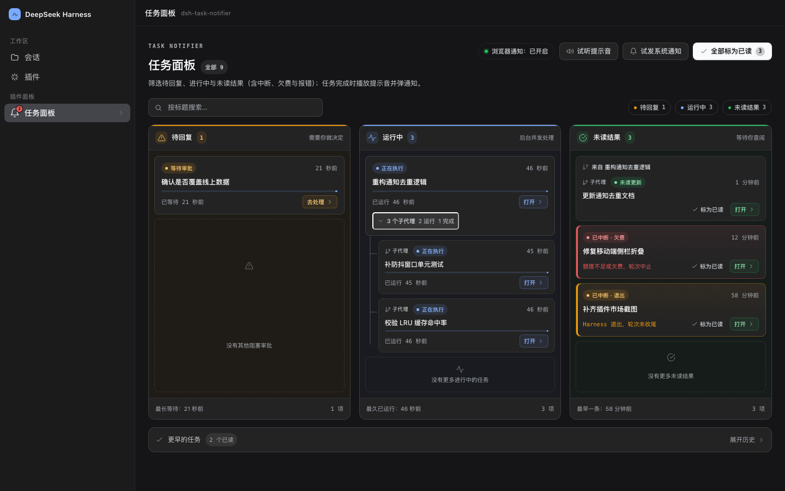 |

| Unread (single lane filter, interrupted cards included) | Needs input (single lane filter) |
|---|---|
| 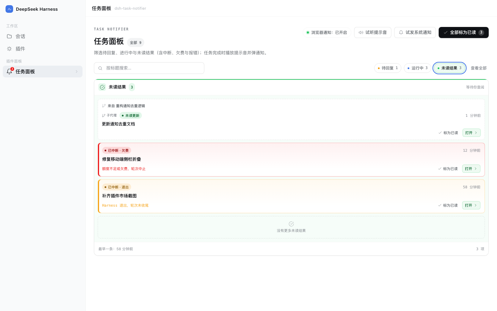 | 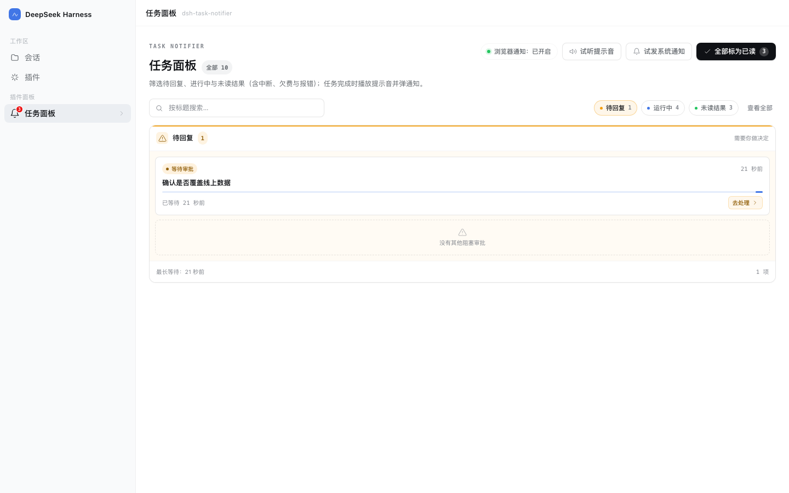 |

| Wide screen (1920×1080 max-width) | Mobile responsive (390×844) |
|---|---|
| 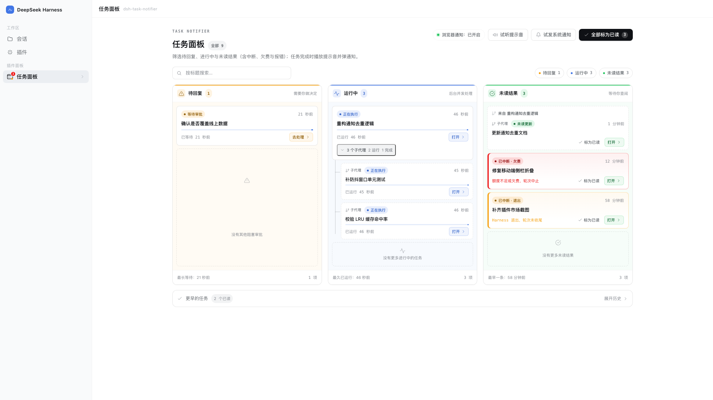 | 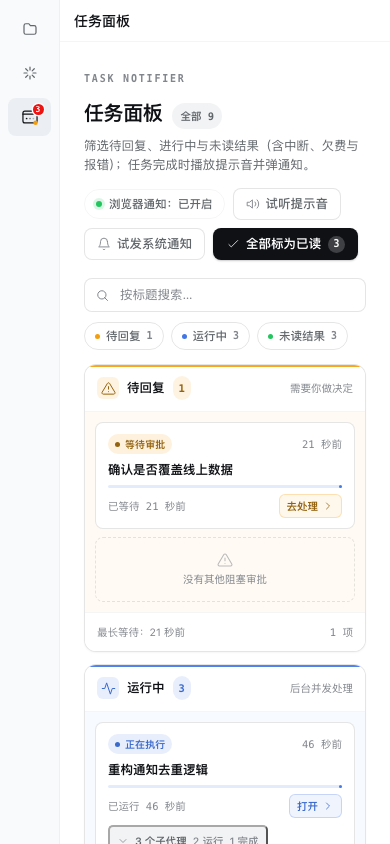 |

Stress test layout (long title truncation and multi-card flow):

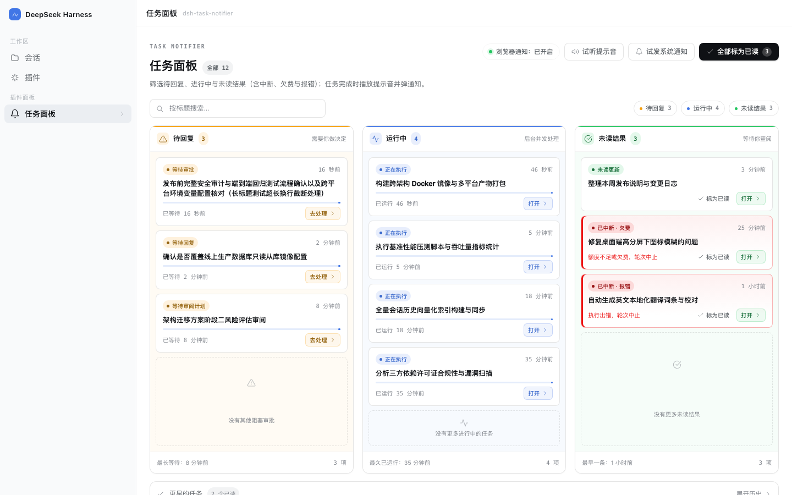

Empty state:

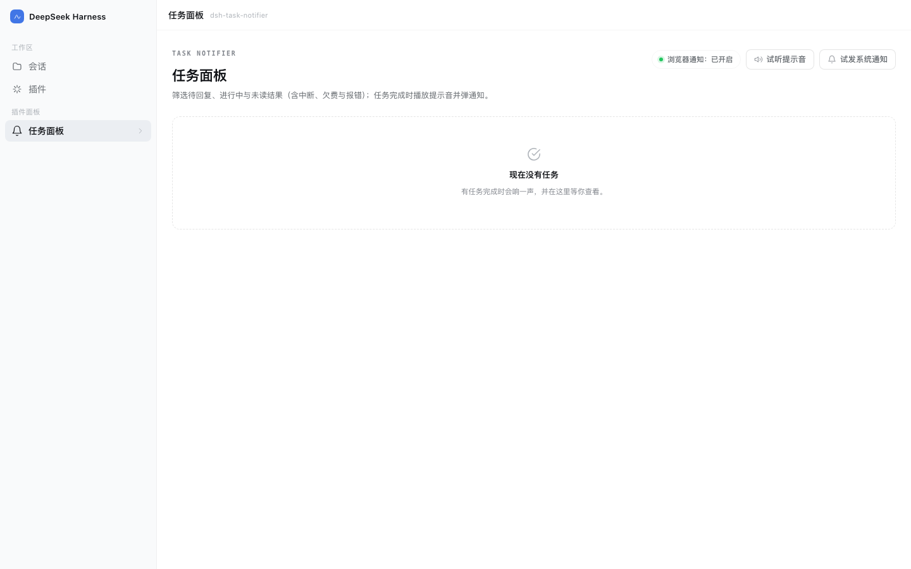

English UI (follows the host language):

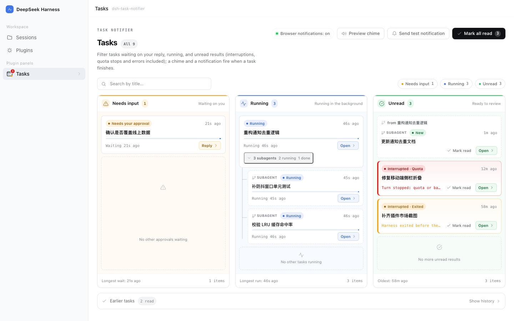

> Screenshots render the real `lib/client.js` with sample data via headless Chrome (`npm run screenshot`).

### Development

```bash
npm test              # node:test: interruption detection, security boundaries, read-sync, zh/en dictionary parity
npm run preview       # local preview page (real client.js + mock data)
npm run screenshot    # regenerate preview/screenshots/*.png
```

## License

[MIT](./LICENSE)
