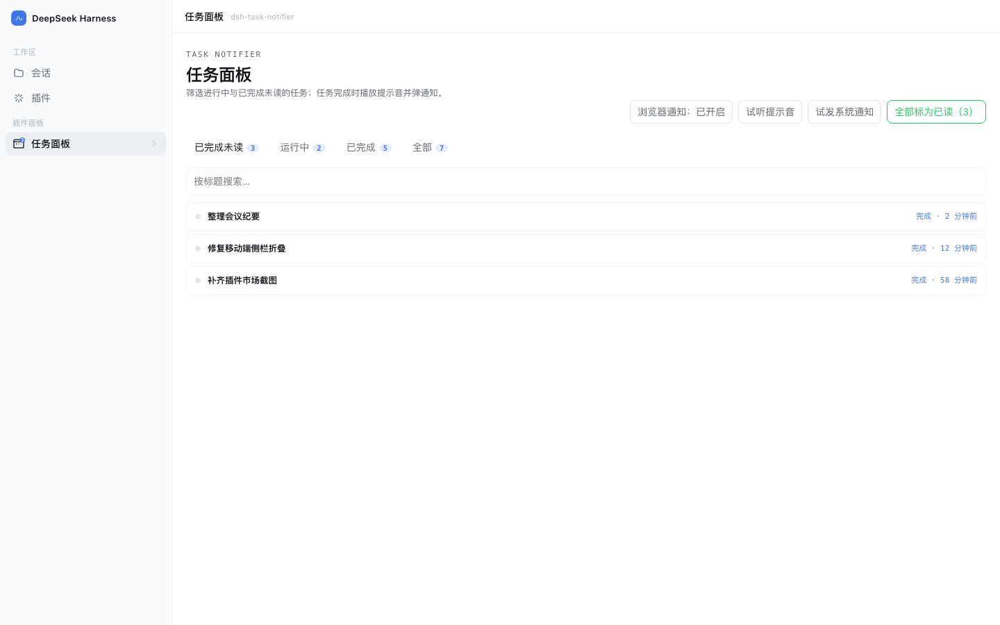
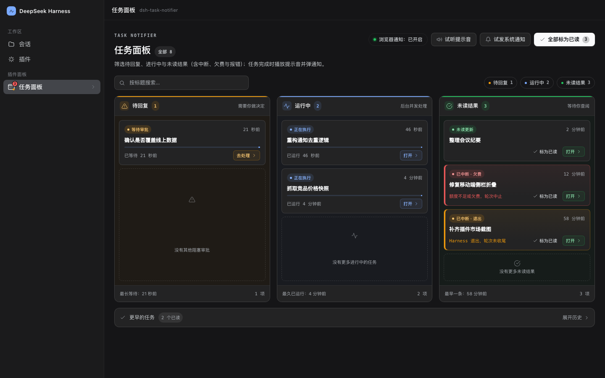
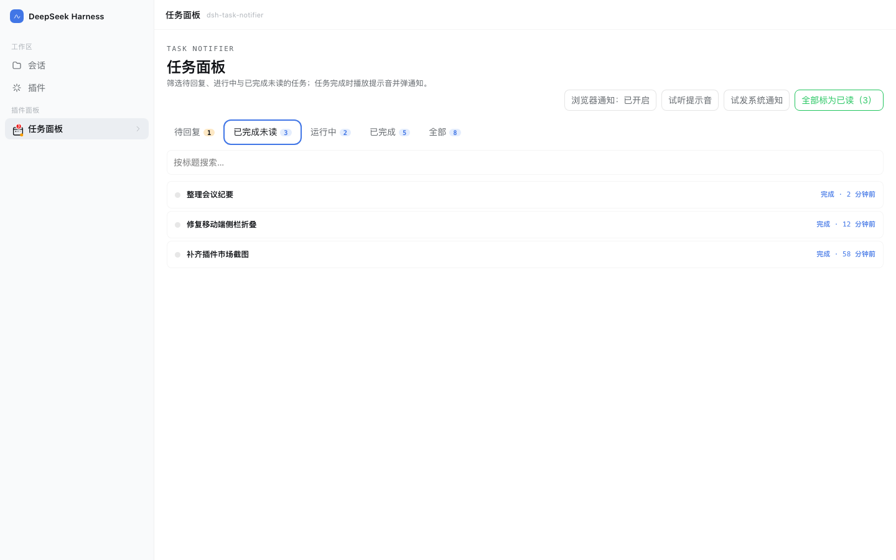
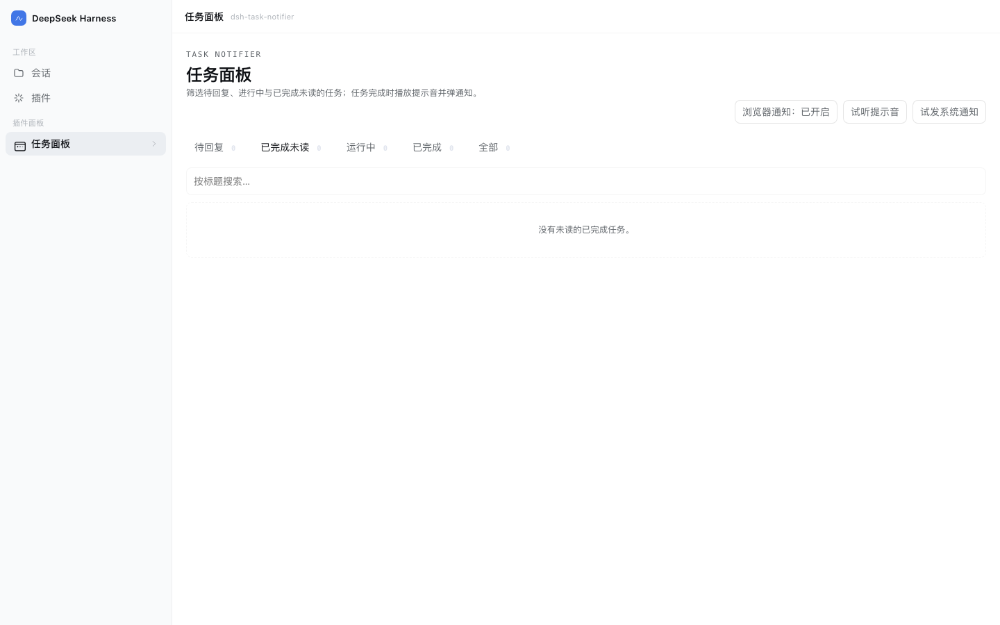
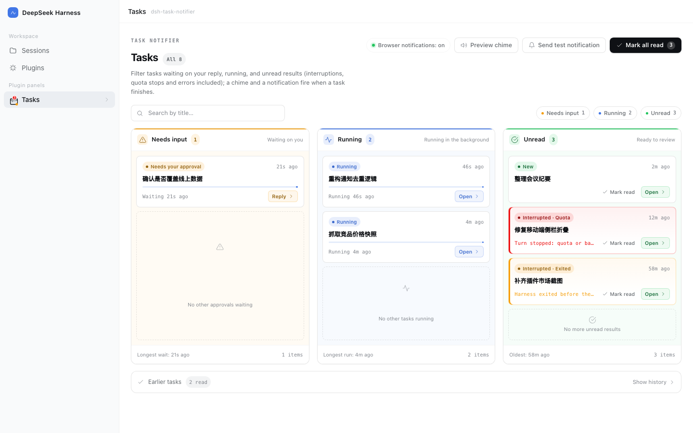

# 任务通知台 · Task Notifier

**中文** | [English](#english)

[](https://www.npmjs.com/package/@polunzh/dsh-task-notifier)
[](./LICENSE)
[](./package.json)



---

## 中文

> DeepSeek Harness（DSH）Web 插件：**任务完成时提醒你**，并给你一个能筛选「已完成未读」的任务面板。

### 它解决什么

DSH 跑长任务时，你切走去干别的，回来才发现早就跑完了。这个插件把「完成」这件事推到你能看到的地方：

- **提示音**：任意会话一轮结束，浏览器合成一段上行 chime（G5→C6），不需要音频素材。
- **通知双通道**：
  - 页面开着且已授权 → 浏览器 `Notification`，点一下跳回对应会话；
  - 页面关了或未授权 → 宿主在 macOS 上弹系统通知（`osascript`），不会双弹（心跳判重）。
- **任务面板**：侧边栏图标（带未读角标）→ 四个筛选：**已完成未读 / 运行中 / 已完成 / 全部**，支持按标题搜索、全部标为已读、试听提示音、试发系统通知。
- **未读不丢**：状态写在 `$DSH_HOME/storages/dsh-task-notifier/state.json`，重启后还在。
- **中英双语**：界面与系统通知文案跟随宿主语言（zh / en）。

### 安装

**方式一：从自建索引安装**（推荐，可自动检测更新）

「插件 → 实验性插件」打开「自定义插件市场」→ **发现 → 添加索引源**，粘贴：

```
https://polunzh.com/dsh-plugins-index/index.json
```

之后搜索「任务通知台 / Task Notifier」安装；有新版本时列表会显示可更新，卸载在「已安装」里。
索引每 6 小时随 npm 刷新，源码见 [dsh-plugins-index](https://github.com/polunzh/dsh-plugins-index)。

**方式二：npm 安装**

```bash
dsh plugin --profile desktop add @polunzh/dsh-task-notifier
```

**方式三：从本地目录安装**（开发调试）

在 DSH 里用 `plugin_manager` 的 `install_bundle`，`target` 填本仓库的绝对路径。

### 配置

全部可省略，写在你的 profile 的 `cordis.patch.yml` 里：

```yaml
- insert:
    - id: polunzh-task-notifier
      name: '@polunzh/dsh-task-notifier'
      config:
        osNotify: auto            # auto | always | off
        sound: true               # 浏览器端提示音开关
        osSound: Glass            # macOS 系统提示音名
        osTitle: DeepSeek Harness # 系统通知标题
```

| 字段 | 默认 | 说明 |
|---|---|---|
| `osNotify` | `auto` | `auto`=页面在线交给浏览器通知、离线兜底系统通知；`always`=恒发系统通知；`off`=不发 |
| `sound` | `true` | 浏览器合成提示音 |
| `osSound` | `Glass` | macOS 自带提示音名（Glass / Ping / Pop …） |
| `osTitle` | `DeepSeek Harness` | 系统通知标题 |

### 隐私与安全

- **不联网**：没有任何出站请求、遥测或远程资源。
- **不上传**：会话标题只写本机 `state.json`，目录 0700、文件 0600。
- **不读凭据**：不碰 `~/.dsh/.credentials.yaml`、`.env`、keychain、SSH key。
- **路由 fail-closed**：宿主连接守卫缺失时直接拒绝，不做"没守卫就放行"。
- **无安装期脚本**：`package.json` 里没有 `preinstall/postinstall/prepare`。

细节、威胁模型与限流参数见 [SECURITY.md](./SECURITY.md)。

### 从 1.1.0 升级 / 共存说明

1.1.1 起浏览器模块 id 改为包名 `@polunzh/dsh-task-notifier`，patch row id 改为 `polunzh-task-notifier`，
这样即使机器上同时装有另一个同名的 `dsh-task-notifier` 插件，也不会因为 id 重复而让 DSH 起不来。
如果你之前用 `link:` 或旧版装过，**请只保留一份**：先在「插件 → 已安装」卸载旧的，再装 1.1.1。

### 兼容性

| 项目 | 要求 |
|---|---|
| DSH | `>=0.2.0-rc.2`（写在 `engines.dsh`） |
| Node | `>=20` |
| 平台 | Web UI 全平台；**系统通知仅 macOS**，其他平台只发浏览器通知 |
| 浏览器通知 | 需要用户点击授权（插件不在后台自动请求） |

### 截图

| 浅色 | 深色 |
|---|---|
|  |  |

| 已完成未读 | 空状态 |
|---|---|
|  |  |

英文界面（跟随宿主语言）：



> 截图为真实界面 + 示例数据，由 `npm run screenshot` 用 headless Chrome 渲染生成。

### 开发

```bash
npm test              # node:test，46 个用例（含安全边界与中英字典一致性）
npm run preview       # 本地预览页（真实 client.js + 模拟数据）
npm run screenshot    # 重新生成 preview/screenshots/*.png
```

仓库结构：

```
lib/index.js   宿主侧：事件订阅、状态持久化、HTTP 路由、系统通知兜底
lib/core.js    纯逻辑：配置归一化、文本净化、AppleScript 转义、请求准入、状态解析（可单测）
lib/client.js  浏览器侧：面板 UI、轮询、提示音、浏览器通知
locale/        Plugin Manager 卡片的显示文案（zh / en）
test/          node:test 单测与集成测试
preview/       预览页与截图（不进 npm 包）
```

---

<a id="english"></a>
## English

> A DeepSeek Harness (DSH) web plugin that **notifies you when a task finishes** and gives you a Tasks panel that filters completed-but-unread sessions.

### What it solves

Long-running DSH sessions finish while you are looking somewhere else. This plugin pushes "done" to where you can see it:

- **Chime** — when any session's turn ends, the browser synthesizes a short ascending chime (G5→C6); no audio assets needed.
- **Two notification channels**:
  - Page open and permission granted → browser `Notification`; clicking it jumps back to that session.
  - Page closed or permission not granted → the host raises a macOS system notification (`osascript`). A heartbeat keeps the two channels from double-firing.
- **Tasks panel** — a sidebar icon with an unread badge and four filters: **unread / running / completed / all**, plus title search, mark-all-read, preview the chime and send a test notification.
- **Unread survives restarts** — state lives in `$DSH_HOME/storages/dsh-task-notifier/state.json`.
- **Bilingual UI** — interface and system-notification text follow the host language (zh / en).

### Install

**Option 1 — via the self-hosted index (recommended; tracks updates)**

In DSH: **Plugins → Experimental plugins** → enable **Custom plugin markets** → **Discover → Add index source**, then paste:

```
https://polunzh.com/dsh-plugins-index/index.json
```

Search for "任务通知台 / Task Notifier" and install. New versions show as update-available; uninstall from **Installed**.
The index refreshes from npm every 6 hours — source at [dsh-plugins-index](https://github.com/polunzh/dsh-plugins-index).

**Option 2 — npm**

```bash
dsh plugin --profile desktop add @polunzh/dsh-task-notifier
```

**Option 3 — from a local checkout (development)**

Use `plugin_manager` with `install_bundle` and point `target` at this repository's absolute path.

### Configuration

Everything is optional. Put it in your profile's `cordis.patch.yml`:

```yaml
- insert:
    - id: polunzh-task-notifier
      name: '@polunzh/dsh-task-notifier'
      config:
        osNotify: auto            # auto | always | off
        sound: true               # browser chime on/off
        osSound: Glass            # macOS system sound name
        osTitle: DeepSeek Harness # system notification title
```

| Field | Default | Meaning |
|---|---|---|
| `osNotify` | `auto` | `auto` = browser notification while the page is live, system notification otherwise; `always` = always system notification; `off` = none |
| `sound` | `true` | Browser-synthesized chime |
| `osSound` | `Glass` | A built-in macOS sound name (Glass / Ping / Pop …) |
| `osTitle` | `DeepSeek Harness` | System notification title |

### Privacy and security

- **No network**: no outbound requests, telemetry or remote assets.
- **No uploads**: session titles are written only to the local `state.json` (directory `0700`, file `0600`).
- **No credential reads**: never touches `~/.dsh/.credentials.yaml`, `.env`, keychain or SSH keys.
- **Fail-closed routing**: if the host connection guard is unavailable, requests are rejected instead of allowed.
- **No install-time scripts**: no `preinstall` / `postinstall` / `prepare` in `package.json`.

Threat model, limits and rate limits are documented in [SECURITY.md](./SECURITY.md).

### Upgrading from 1.1.0 / coexistence

Since 1.1.1 the browser module id is the package name (`@polunzh/dsh-task-notifier`) and the patch row id is
`polunzh-task-notifier`, so a different plugin that happens to share the old ids can no longer break DSH's boot.
If you previously installed a `link:` copy or an older version, **keep only one**: uninstall the old entry from
**Plugins → Installed** first, then install 1.1.1.

### Compatibility

| Item | Requirement |
|---|---|
| DSH | `>=0.2.0-rc.2` (declared in `engines.dsh`) |
| Node | `>=20` |
| Platform | Any platform for the web UI; **system notifications are macOS-only**, other platforms get browser notifications |
| Browser notifications | Require an explicit user gesture (the plugin never prompts in the background) |

### Screenshots

| Light | Dark |
|---|---|
|  |  |

| Unread | Empty state |
|---|---|
|  |  |

English UI (follows the host language):


> Screenshots render the real `lib/client.js` with sample data via headless Chrome (`npm run screenshot`).

### Development

```bash
npm test              # node:test, 46 cases (security boundaries + zh/en dictionary parity)
npm run preview       # local preview page (real client.js + mock data)
npm run screenshot    # regenerate preview/screenshots/*.png
```

Layout:

```
lib/index.js   host half: session events, state persistence, HTTP routes, system notification fallback
lib/core.js    pure logic: config normalization, text sanitizing, AppleScript escaping, request admission
lib/client.js  browser half: panel UI, polling, chime, browser notifications
locale/        Plugin Manager display metadata (zh / en)
test/          node:test unit and integration tests
preview/       preview harness and screenshots (not shipped in the npm package)
```

## License

[MIT](./LICENSE)
