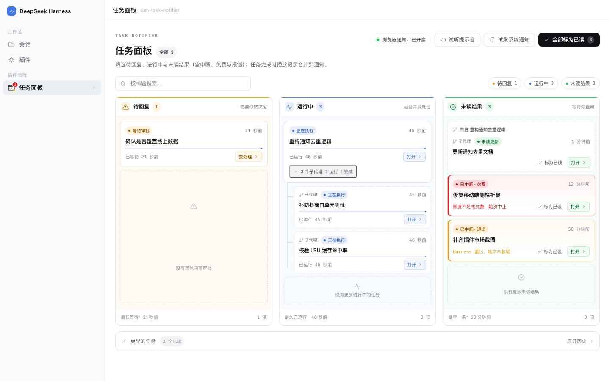
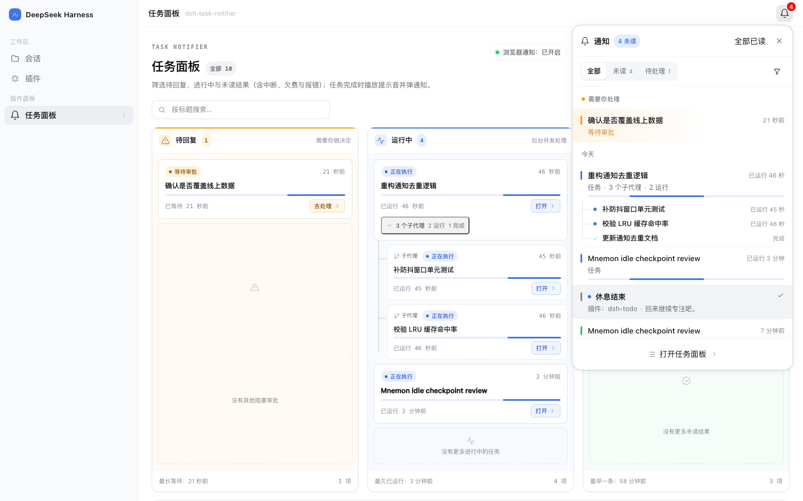
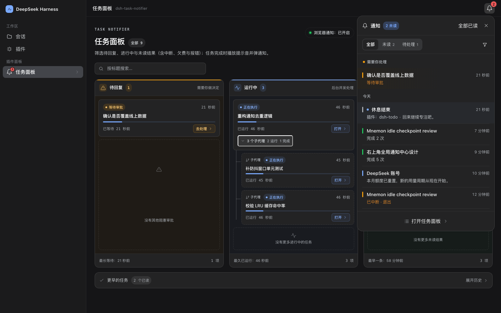
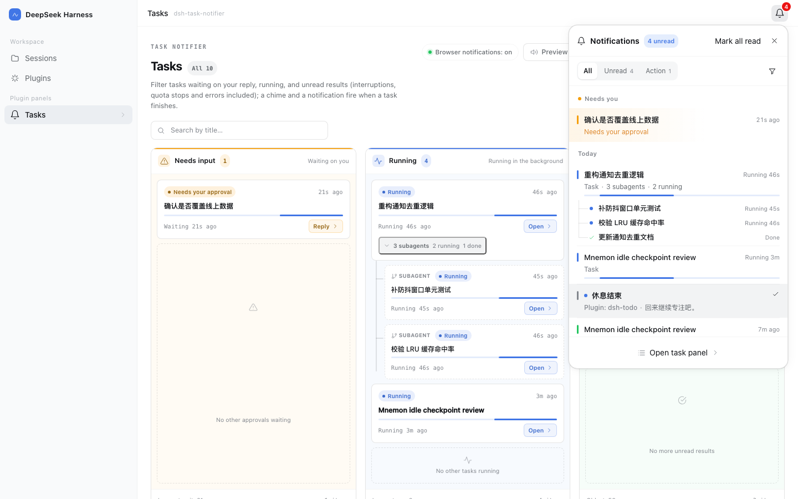
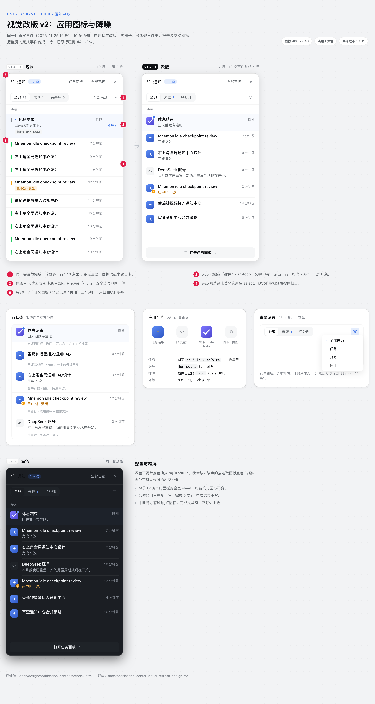
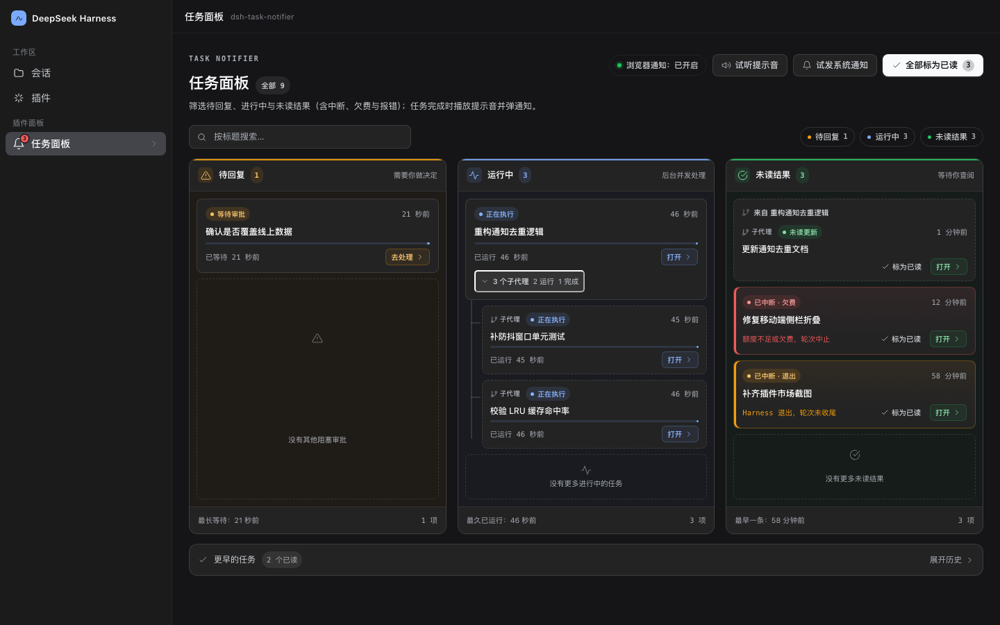
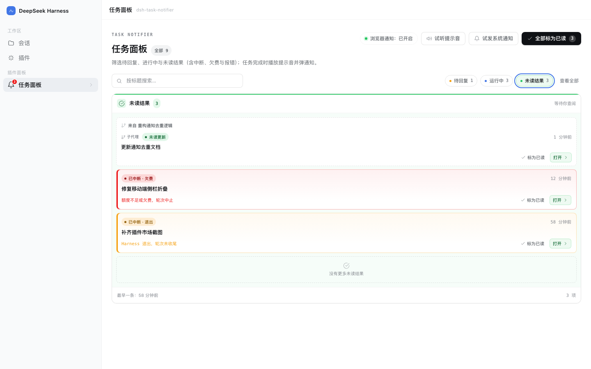
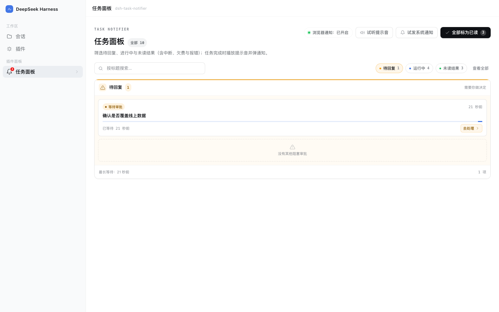
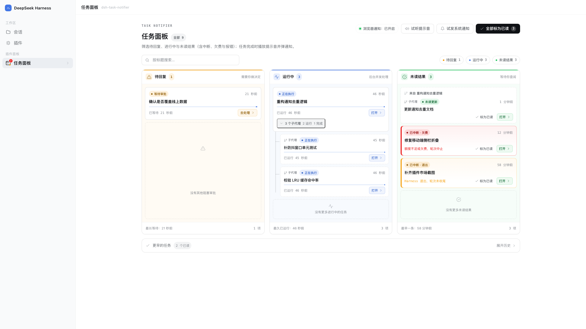
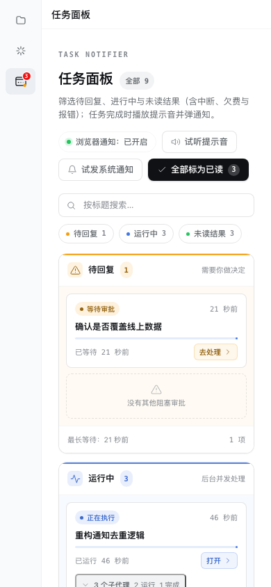

# 任务通知台 · Task Notifier

**中文** | [English](./README.md)

[](https://www.npmjs.com/package/@polunzh/dsh-task-notifier)
[](https://dshopen.org/zh/plugins/@polunzh/dsh-task-notifier/)
[](https://dsh.127.dev/)
[](./LICENSE)
[](./package.json)



---

> DeepSeek Harness（DSH）Web 插件：**任务完成或中断时提醒你**，并在右上角提供一个跨所有界面的**通知中心**——任务结果、账号公告和其它插件发来的通知都在这里，点开即可处理。

### 它解决什么

DSH 跑长任务时，你切走去干别的，回来才发现早就跑完了。这个插件把「完成」这件事推到你能看到的地方：

- **右上角通知中心**：任何界面（会话、插件页、设置页）右上角都有一个铃铛，未读角标汇总所有来源；点开是统一收件箱，按「全部 / 未读 / 待处理」和来源筛选，底部「打开任务面板」进入原来的三列看板。每行左侧是一条状态色条（完成绿、中断琥珀/红、账号蓝、插件灰）；插件通知在副行开头写明「插件：dsh-todo」，来源一眼可辨；同一会话的重复完成合成一行，写「完成 N 次」，未读也不再按次数翻倍。
- **多来源聚合**：本插件的任务事件、内置账号公告、以及其它插件主动发来的通知（`ctx.notifications.post()` 或 `window.dshNotifications`）都汇到这里；系统通知与提示音只由本插件统一弹出，避免各来源重复打扰。
- **提示音**：任意会话一轮结束，浏览器合成一段上行 chime（G5→C6），不需要音频素材。
- **通知双通道**：
  - 页面开着且已授权 → 浏览器 `Notification`，点一下跳回对应会话；
  - 页面关了或未授权 → 宿主在 macOS 上弹系统通知（`osascript`），不会双弹（心跳判重）。
- **待回复状态**：Agent 向你提问、等你审阅计划或等你审批时，右上角铃铛的角标会把它计入「待处理」，面板顶部「需要你处理」置顶，点开直接回到那个等你决定的会话。
- **中断也会展示**：退出 DSH 或崩溃时未收尾的轮次、欠费/额度耗尽、执行报错，都会以「已中断 · 退出 / 欠费 / 报错」的警告卡片留在收件箱里；系统通知同步说明中断原因，重新发消息开跑时自动清掉中断标记。
- **三列看板**：在通知面板底部点「展开完整任务面板」进入，一屏同时看到**待回复 / 运行中 / 未读结果**三列，顶部 chip 可单独筛选单列，底部「更早的任务」可展开历史；支持按标题搜索、全部标为已读、试听提示音、试发系统通知。
- **会话 / 子代理任务树**：AgentTeams 或 subagent 派生的会话按父子关系缩进挂在父会话下，父卡标「N 个子代理 · 运行 / 完成」并可折叠；子代理落在别的状态栏时用「来自〈父〉」标注来源，父子关系不会因为分栏而断掉。
- **自动同步已读**：切换会话时自动标记未读任务为已读。
- **未读不丢**：任务和通知快照写在 `$DSH_HOME/storages/dsh-task-notifier/`（`state.json` + `notifications.json`），重启后还在。
- **中英双语**：界面与系统通知文案跟随宿主语言（zh / en）。

### 安装

**方式一：开放插件市场安装**（推荐，可在市场点赞）

已收录进社区市场（分类「工作流与协作」，已通过源码级验证 ✅）：在「插件 → 实验性插件」打开「自定义插件市场」→ **发现 → 添加索引源**，粘贴：

```
https://dshopen.org/index.json
```

之后搜索「任务通知台 / Task Notifier」安装；市场页与点赞见 [dshopen 插件页](https://dshopen.org/zh/plugins/@polunzh/dsh-task-notifier/)。

**方式二：从自建索引安装**（可自动检测更新）

同样在「发现 → 添加索引源」粘贴：

```
https://dsh.127.dev/index.json
```

之后搜索「任务通知台 / Task Notifier」安装；有新版本时列表会显示可更新，卸载在「已安装」里。
索引每 6 小时随 npm 刷新，源码见 [dsh-plugins-index](https://github.com/polunzh/dsh-plugins-index)。

**方式三：npm 安装**

```bash
dsh plugin --profile desktop add @polunzh/dsh-task-notifier
```

### 配置

全部可省略，写在你的 profile 的 `cordis.patch.yml` 里：

```yaml
- insert:
    - id: polunzh-task-notifier
      name: '@polunzh/dsh-task-notifier'
      config:
        osNotify: auto            # auto | always | off
        sound: true               # 浏览器端提示音开关
        osSound: Glass            # macOS 系统提示音名
        osTitle: DeepSeek Harness # 系统通知标题
```

| 字段 | 默认 | 说明 |
|---|---|---|
| `osNotify` | `auto` | `auto`=页面在线交给浏览器通知、离线兜底系统通知；`always`=恒发系统通知；`off`=不发 |
| `sound` | `true` | 浏览器合成提示音 |
| `osSound` | `Glass` | macOS 自带提示音名（Glass / Ping / Pop …） |
| `osTitle` | `DeepSeek Harness` | 系统通知标题 |

### 其它插件如何接入

其它插件可以把通知送进同一个收件箱：

- **客户端**：服务可用时 `ctx.notifications.post({ id, source: 'plugin', sourceLabel, title, body, tone })`；零依赖兜底是 `window.dshNotifications.post(...)`。
- **宿主**：`inject: ['notifications']` 后调 `ctx.notifications.post(entry)`。

`source` 取 `task | account | plugin`；`id` 是去重键。账号公告通过宿主账号服务读取，只进收件箱，不弹系统通知。

### 隐私与安全

- **不新增出站连接**：插件自身不发起网络请求、不含遥测或远程资源；账号公告来源复用宿主已有的账号服务，不额外直连。
- **只写本机**：任务与通知快照写在 `$DSH_HOME/storages/dsh-task-notifier/`（`state.json`、`notifications.json`），目录 0700、文件 0600。
- **不读凭据**：不碰 `~/.dsh/.credentials.yaml`、`.env`、keychain、SSH key。
- **路由 fail-closed**：宿主连接守卫缺失时直接拒绝，不做"没守卫就放行"。
- **无安装期脚本**：`package.json` 里没有 `preinstall/postinstall/prepare`。

细节、威胁模型与限流参数见 [SECURITY.md](./SECURITY.md)。

### 兼容性

| 项目 | 要求 |
|---|---|
| DSH | `>=0.2.0-rc.2`（写在 `engines.dsh`） |
| Node | `>=20` |
| 平台 | Web UI 全平台；**系统通知仅 macOS**，其他平台只发浏览器通知 |
| 浏览器通知 | 需要用户点击授权（插件不在后台自动请求） |

### 截图

| 右上角通知中心（浅色） | 右上角通知中心（深色） |
|---|---|
|  |  |

| 通知中心（英文） | 设计稿（行结构与状态色） |
|---|---|
|  |  |

| 浅色看板 | 深色看板 |
|---|---|
|  |  |

| 未读结果（单列筛选，含中断卡片） | 待回复（单列筛选） |
|---|---|
|  |  |

| 宽屏收敛（1920×1080） | 移动端响应式（390×844） |
|---|---|
|  |  |

> 截图为真实界面 + 示例数据，由 `npm run screenshot` 用 headless Chrome 渲染生成。

### 开发

```bash
npm test              # node:test，中断识别、安全边界、已读同步与中英字典一致性
npm run preview       # 本地预览页（真实 client.js + 模拟数据）
npm run screenshot    # 重新生成 preview/screenshots/*.png
```
