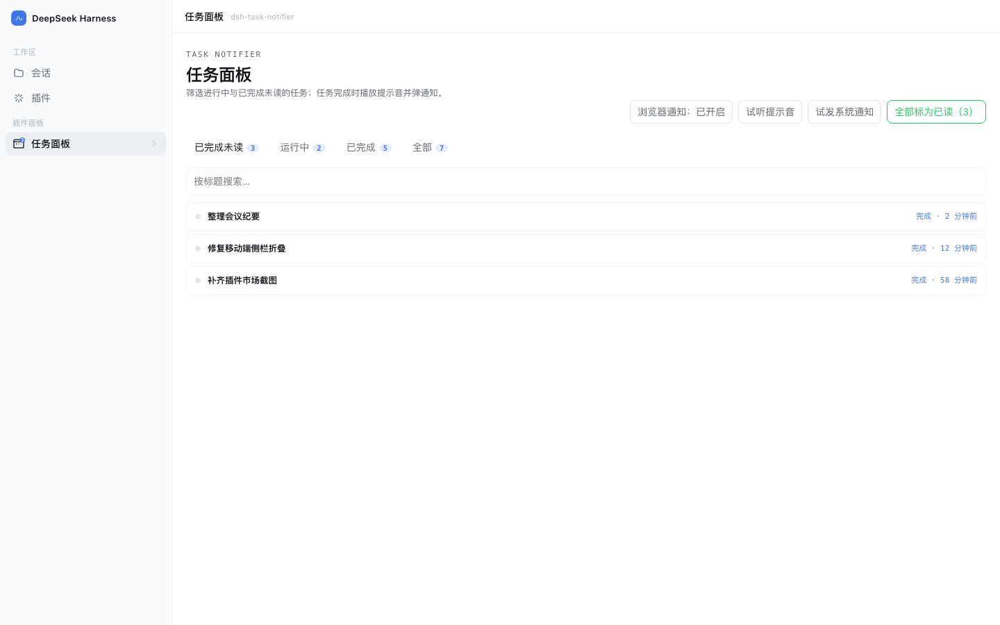
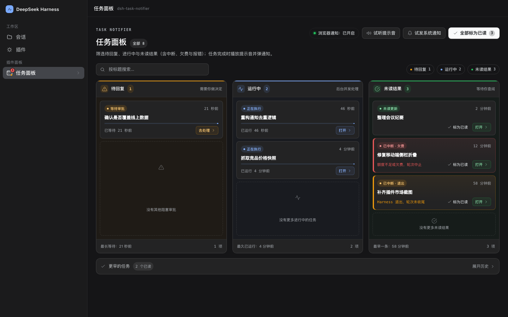
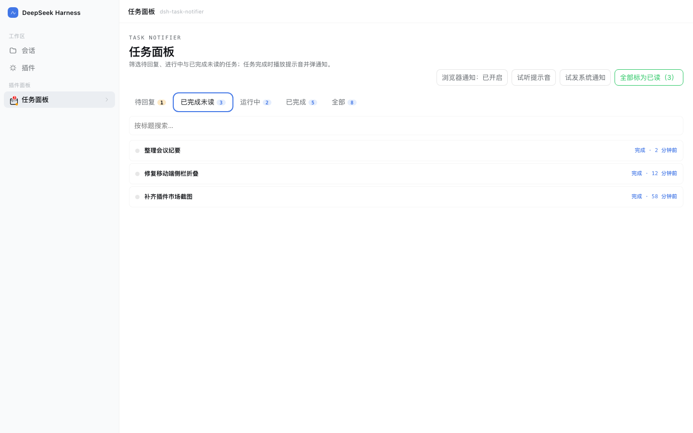
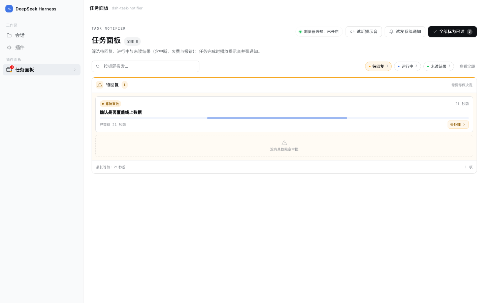
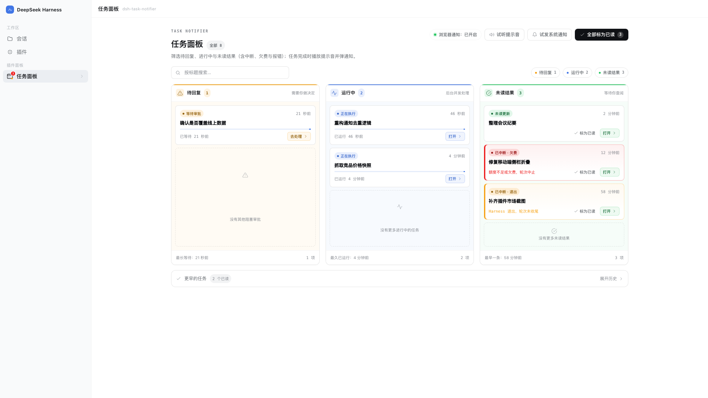
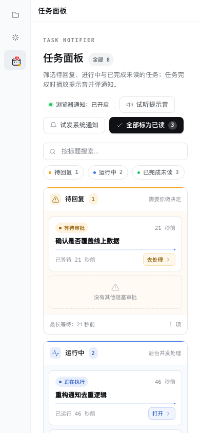

# 任务通知台 · Task Notifier

**中文** | [English](./README.md)

[](https://www.npmjs.com/package/@polunzh/dsh-task-notifier)
[](https://dshopen.org/zh/plugins/@polunzh/dsh-task-notifier/)
[](./LICENSE)
[](./package.json)



---

> DeepSeek Harness（DSH）Web 插件：**任务完成时提醒你**，并提供一屏同时展示「待回复 / 运行中 / 已完成未读」的三列看板任务面板。

### 它解决什么

DSH 跑长任务时，你切走去干别的，回来才发现早就跑完了。这个插件把「完成」这件事推到你能看到的地方：

- **提示音**：任意会话一轮结束，浏览器合成一段上行 chime（G5→C6），不需要音频素材。
- **通知双通道**：
  - 页面开着且已授权 → 浏览器 `Notification`，点一下跳回对应会话；
  - 页面关了或未授权 → 宿主在 macOS 上弹系统通知（`osascript`），不会双弹（心跳判重）。
- **待回复状态**：Agent 向你提问、等你审阅计划或等你审批时，侧栏图标亮起琥珀色脉冲点，面板「待回复」列置顶提示，点开直接回到那个等你决定的会话。
- **三列看板面板**：侧边栏图标（带未读角标）→ 一屏同时看到**待回复 / 运行中 / 已完成未读**三列，顶部 chip 可单独筛选单列，底部「更早完成」可展开历史；支持按标题搜索、全部标为已读、试听提示音、试发系统通知。
- **自动同步已读**：切换会话时自动标记未读任务为已读。
- **未读不丢**：状态写在 `$DSH_HOME/storages/dsh-task-notifier/state.json`，重启后还在。
- **中英双语**：界面与系统通知文案跟随宿主语言（zh / en）。

### 安装

**方式一：开放插件市场安装**（推荐，可在市场点赞）

已收录进社区市场（分类「工作流与协作」，已通过源码级验证 ✅）：在「插件 → 实验性插件」打开「自定义插件市场」→ **发现 → 添加索引源**，粘贴：

```
https://dshopen.org/index.json
```

之后搜索「任务通知台 / Task Notifier」安装；市场页与点赞见 [dshopen 插件页](https://dshopen.org/zh/plugins/@polunzh/dsh-task-notifier/)。

**方式二：从自建索引安装**（可自动检测更新）

同样在「发现 → 添加索引源」粘贴：

```
https://dsh.127.dev/index.json
```

之后搜索「任务通知台 / Task Notifier」安装；有新版本时列表会显示可更新，卸载在「已安装」里。
索引每 6 小时随 npm 刷新，源码见 [dsh-plugins-index](https://github.com/polunzh/dsh-plugins-index)。

**方式三：npm 安装**

```bash
dsh plugin --profile desktop add @polunzh/dsh-task-notifier
```

### 配置

全部可省略，写在你的 profile 的 `cordis.patch.yml` 里：

```yaml
- insert:
    - id: polunzh-task-notifier
      name: '@polunzh/dsh-task-notifier'
      config:
        osNotify: auto            # auto | always | off
        sound: true               # 浏览器端提示音开关
        osSound: Glass            # macOS 系统提示音名
        osTitle: DeepSeek Harness # 系统通知标题
```

| 字段 | 默认 | 说明 |
|---|---|---|
| `osNotify` | `auto` | `auto`=页面在线交给浏览器通知、离线兜底系统通知；`always`=恒发系统通知；`off`=不发 |
| `sound` | `true` | 浏览器合成提示音 |
| `osSound` | `Glass` | macOS 自带提示音名（Glass / Ping / Pop …） |
| `osTitle` | `DeepSeek Harness` | 系统通知标题 |

### 隐私与安全

- **不联网**：没有任何出站请求、遥测或远程资源。
- **不上传**：会话标题只写本机 `state.json`，目录 0700、文件 0600。
- **不读凭据**：不碰 `~/.dsh/.credentials.yaml`、`.env`、keychain、SSH key。
- **路由 fail-closed**：宿主连接守卫缺失时直接拒绝，不做"没守卫就放行"。
- **无安装期脚本**：`package.json` 里没有 `preinstall/postinstall/prepare`。

细节、威胁模型与限流参数见 [SECURITY.md](./SECURITY.md)。

### 兼容性

| 项目 | 要求 |
|---|---|
| DSH | `>=0.2.0-rc.2`（写在 `engines.dsh`） |
| Node | `>=20` |
| 平台 | Web UI 全平台；**系统通知仅 macOS**，其他平台只发浏览器通知 |
| 浏览器通知 | 需要用户点击授权（插件不在后台自动请求） |

### 截图

| 浅色看板 | 深色看板 |
|---|---|
|  |  |

| 已完成未读（单列筛选） | 待回复（单列筛选） |
|---|---|
|  |  |

| 宽屏收敛（1920×1080） | 移动端响应式（390×844） |
|---|---|
|  |  |

> 截图为真实界面 + 示例数据，由 `npm run screenshot` 用 headless Chrome 渲染生成。

### 开发

```bash
npm test              # node:test，60 个用例（含侧边栏已读同步、安全边界与中英字典一致性）
npm run preview       # 本地预览页（真实 client.js + 模拟数据）
npm run screenshot    # 重新生成 preview/screenshots/*.png
```
